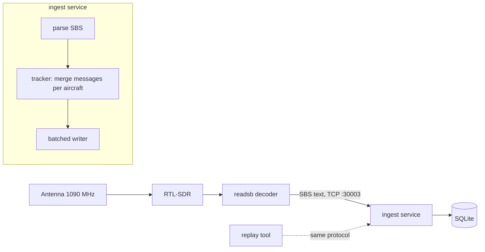

# ADS-B Station

A home ADS-B receiver station in Granada, Spain: it listens to the position broadcasts that
aircraft transmit on 1090 MHz, stores every track, and (in later phases) shows live traffic
on a map with analytics and alerts.

> **Status: phase 0 of 6.** The data pipeline runs end to end against recorded or simulated
> feeds. The receiver hardware (RTL-SDR + 1090 MHz antenna) is the next step.

## How it works



1. **readsb** decodes the radio signal and serves one text line per message (SBS-1 format).
2. **ingest** reads the TCP feed, parses each line, and merges the partial messages
   (callsign, position, velocity, squawk...) into the current state of each aircraft.
3. Every new position becomes a row in `positions`, linked to the aircraft that sent it.

The **replay tool** speaks the same protocol as readsb, so the whole pipeline can be developed
and tested without hardware, at real speed or as fast as possible.

## Quick start

Requires Python 3.11+. No other dependencies for phase 0.

```bash
python -m venv .venv
source .venv/bin/activate          # Windows: .venv\Scripts\activate
pip install -e ".[dev]"

# 1. Generate 10 minutes of SIMULATED traffic around Granada (until the antenna arrives)
adsb-simulate --minutes 10 --out data/recordings/simulated.rec

# 2. Serve it like a receiver would (10x speed)
adsb-replay data/recordings/simulated.rec --speed 10

# 3. In another terminal, ingest it
adsb-ingest --db data/adsb.sqlite3
```

With a real receiver, skip steps 1-2 and point `adsb-ingest` at readsb (`--host`/`--port`).
`adsb-record` saves a live feed to a file that `adsb-replay` can play back later.

Run the checks:

```bash
ruff check .
pytest
```

## Design decisions

| Decision | Why |
|---|---|
| Consume readsb's decoded SBS output first | Gets real data flowing early. Writing my own Mode S decoder is phase 5, tested against readsb's output. |
| Record/replay with receive timestamps | Deterministic tests and demos that do not depend on live traffic or on my PC being on. |
| SQLite in phase 0 | Zero setup, one file, enough for one receiver (~10-50 rows/s). All SQL is in `store.py`; PostgreSQL + PostGIS arrives with the API and spatial queries. |
| Batched writes in a worker thread | One transaction per second instead of one per message; disk I/O never blocks reading the socket. |
| Reconnect with exponential backoff | The decoder can restart without taking ingest down. |
| Receive time, not decoder time | SBS timestamps carry no timezone; the ingest clock is the single source of truth (and injectable in tests). |

## Data honesty

Simulated data is only for development. Simulated aircraft always use callsigns starting
with `SIM`, and simulated recordings start with `# source: simulated`. Nothing simulated is
ever presented as real traffic.

## Roadmap

- [x] **0. Pipeline without hardware:** SBS parser, tracker, SQLite store, ingest service, record/replay/simulate tools, tests, CI
- [ ] **1. Real data:** RTL-SDR + readsb on Linux, first real recordings
- [ ] **2. Flight model:** split tracks into flights, filter bad positions, PostgreSQL + PostGIS, REST + WebSocket API
- [ ] **3. Live map:** React + TypeScript + MapLibre: live aircraft, trails, flight replay
- [ ] **4. Analytics and alerts:** antenna range (polar plot), busiest routes, Telegram alerts for 7700/7600/7500 squawks and watch-listed aircraft
- [ ] **5. Own Mode S decoder:** CRC, identification, CPR position decoding, velocity; validated against readsb
- [ ] **6. Public demo:** deployed site replaying a recorded day

## Project layout

```text
src/adsb_station/
  sbs.py          SBS-1 line parser
  tracker.py      merges messages into per-aircraft state, emits position fixes
  store.py        SQLite schema and batched writes
  ingest.py       asyncio TCP client: feed -> parser -> tracker -> store
  recording.py    recording file format
  tools/          simulate.py, replay.py, record.py
tests/            unit tests + an end-to-end test over a real TCP socket
```

## License

MIT
